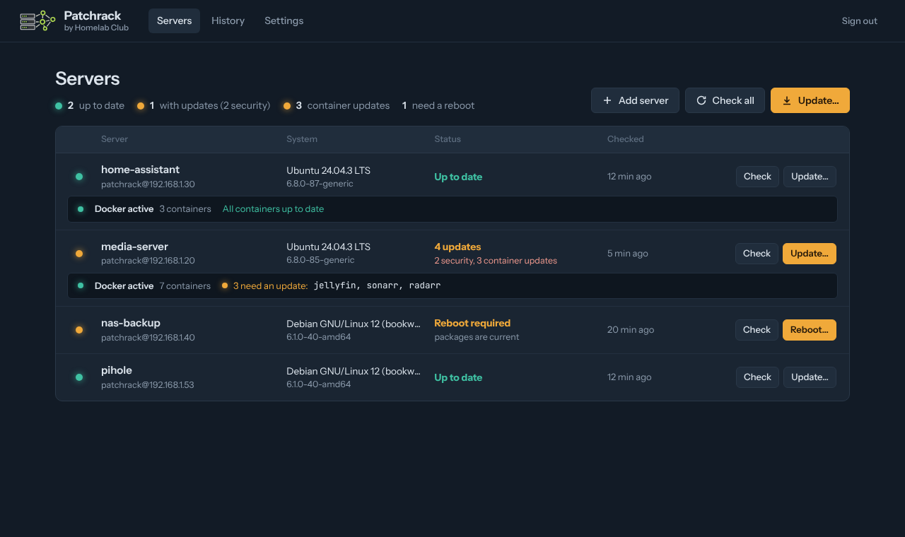
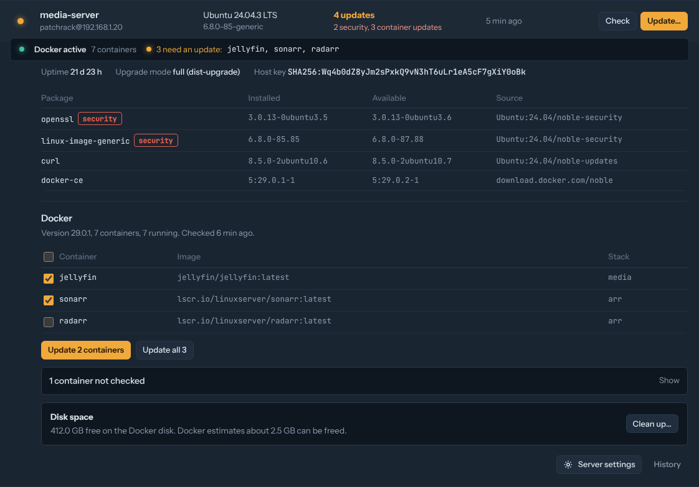
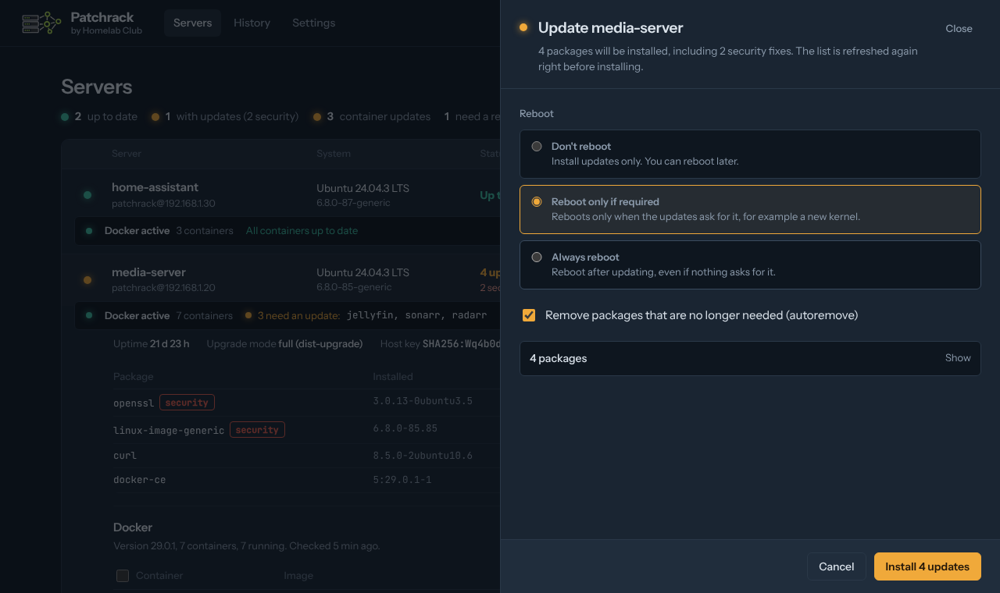

# Homelab Club Patchrack

Patchrack is a small self-hosted web app that keeps the Linux servers in your homelab up to date. It checks your Debian and Ubuntu servers and their Docker containers for updates, and installs them when you press a button.



## What it does

- **System updates (apt):** checks every server on a schedule, lists pending packages and highlights security updates.
- **Your call on reboots:** for each update you choose to not reboot, reboot only if required, or always reboot. Patchrack waits for the server to come back and confirms it's up to date.
- **Live progress:** the apt and Docker output streams into the browser while it works. Close the panel and the job keeps running.
- **Docker containers:** shows whether Docker is active, how many containers run and which have a newer image. Update them all or pick them by hand, and clean up unused images to free disk space.
- **Notifications:** Pushover and Prowl, for new updates, finished or failed updates and unreachable servers.
- **No agents:** servers are reached over SSH with a key. Nothing extra is installed on them.
- **Secrets encrypted:** SSH keys, passwords and tokens are encrypted at rest with AES-256-GCM.



## Project status

Version 0.1.0 is the first public release. It's used and tested in a homelab, but it's young. Try it on a server you can afford to experiment with first, and please [open an issue](../../issues) when something doesn't work.

| Area | Tested on |
|---|---|
| Servers | Ubuntu 24.04. Debian 12 uses the same tools but hasn't been tested yet. |
| Docker | Docker Engine 29, Docker Compose v2 stacks and plain `docker run` containers |
| Patchrack host | Linux, and Windows with Docker Desktop |

## Install

You need Docker with the Compose plugin on the machine that runs Patchrack. It reaches your servers over SSH, so it has to be on the same network or VPN.

### 1. Get the files

```bash
git clone https://github.com/HomelabClub/patchrack.git
cd patchrack
```

### 2. Create the master secret

This secret encrypts everything Patchrack stores. Keep a copy somewhere safe, such as your password manager: without it, the stored keys can't be decrypted.

**Linux or macOS**

```bash
mkdir -p secrets && chmod 700 secrets
openssl rand -base64 48 > secrets/patchrack_secret
sudo chown 10001:10001 secrets/patchrack_secret   # the user inside the container
sudo chmod 400 secrets/patchrack_secret
```

**Windows (PowerShell)**

```powershell
New-Item -ItemType Directory -Force secrets | Out-Null
$b = New-Object byte[] 48
[Security.Cryptography.RandomNumberGenerator]::Create().GetBytes($b)
[Convert]::ToBase64String($b) | Set-Content -NoNewline -Encoding ascii secrets\patchrack_secret
```

### 3. Start it

```bash
docker compose up -d --build
```

Open `http://<docker-host>:8080` and create your account.

To use the ready-made image instead of building it yourself, replace `build: .` in `docker-compose.yml` with `image: ghcr.io/HomelabClub/patchrack:latest`. Images are published for `amd64` and `arm64` (Raspberry Pi 4 and 5).

## Add your servers

1. Choose **Add server**, fill in the name and IP address, and keep **Use the Patchrack key** selected.
2. Copy the **setup command** from that panel. It's also under Settings.
3. On the server, become root (`sudo -i`) and paste the command.
4. Back in Patchrack, choose **Add and test connection**. All three checks should be green.

The setup command:

- creates a `patchrack` user and adds Patchrack's public key to it
- adds `/etc/sudoers.d/patchrack`, which lets that user run only `apt-get`, `dpkg --configure -a`, `systemctl reboot` and, when Docker is installed, `docker`, without a password. The file is checked with `visudo` before it's installed.

It doesn't change existing users, passwords, SSH settings or anything else. If you install Docker later, run the command again. Running it twice is safe.

To remove Patchrack's access from a server:

```bash
userdel -r patchrack
rm /etc/sudoers.d/patchrack
```

If you'd rather use your own user and key, choose **Use my own private key** and pick how sudo works for that user.

## Updating servers

- **Check** refreshes the package lists and shows what's pending. Click a server to see the packages.
- **Update…** asks how to handle a reboot, then installs and streams the output.
- **Update…** at the top of the page updates several servers at once.
- **History** keeps every check and update with its full log.



## Docker containers

Each server with Docker shows a status line with whether Docker is active, the number of containers and the containers that need an update. Click it to open the Docker section.

- Only containers with a newer image in their registry are listed. Tick the ones you want and choose **Update**, or choose **Update all**.
- For each container, Patchrack downloads the new image, stops the container, starts a new one with the same settings (ports, volumes, networks, environment, labels and restart policy) and waits until it runs steadily. If it doesn't, the previous container is restored.
- Containers that share another container's network, such as a VPN container in an *arr stack, are reconnected automatically.
- Docker Compose stacks keep working as before. The next `docker compose up` sees the updated containers as current.
- **Clean up…** removes unused images, build cache and unused networks, and optionally stopped containers, and reports how much space was freed. Volumes are never removed.

Not checked or updated:

- containers with the label `patchrack.enable=false`, for example a database you want to update by hand
- images pinned to an exact version (`image@sha256:…`)
- images from registries that need a login
- Patchrack's own container, when it runs on a managed server

Patchrack doesn't change your compose files. Rootless Docker and Podman aren't supported yet.

## Notifications

**Pushover:** create an application at pushover.net to get an API token, and copy your user key from the dashboard. Paste both under Settings, turn Pushover on and press **Send test**.

**Prowl:** create an API key at prowlapp.com under API Keys, paste it, turn Prowl on and press **Send test**.

Scheduled checks send one summary message when new updates appear, not one per server. Container updates get their own message, which you can turn off separately.

## Security

- **Secrets at rest:** SSH private keys, key passphrases, sudo passwords and notification tokens are encrypted with AES-256-GCM. The key comes from the master secret, which is kept outside the database. Each value is bound to its record, so encrypted values can't be swapped between servers.
- **Host keys:** the first connection to a server records its host key. If it changes later, Patchrack refuses to connect until you clear the trusted key in that server's settings.
- **Web login:** passwords are hashed with scrypt. Five failed sign-ins lock that address out for five minutes. Sessions expire after 12 hours.
- **Access on your servers:** allowing `apt-get` or `docker` through sudo is effectively root access, so treat the Patchrack key like a root key. The sudo rule limits mistakes, not a determined attacker who has the key.
- **Docker access:** Patchrack reaches the Docker API through `docker system dial-stdio` over SSH. No Docker port is opened.
- **Network:** keep Patchrack on your LAN or behind a VPN, not on the internet. For HTTPS, put it behind a reverse proxy (Caddy, Traefik, Nginx Proxy Manager) and set `COOKIE_SECURE: "true"`.

To report a security problem, see [SECURITY.md](SECURITY.md).

## Configuration

| Variable | Default | Purpose |
|---|---|---|
| `PATCHRACK_SECRET_FILE` | — | Path to the master secret file (recommended) |
| `PATCHRACK_SECRET` | — | Master secret as a value, if you don't use a file |
| `PATCHRACK_DATA` | `/data` | Where the database lives |
| `COOKIE_SECURE` | `false` | Set to `true` when served over HTTPS |
| `PATCHRACK_SOURCE_URL` | set by the release image | The "Source code" link in the app |
| `LOG_LEVEL` | `INFO` | Python log level |

If neither secret variable is set, Patchrack generates `/data/.master.key` and logs a warning. That works, but it keeps the key next to the data it protects.

## Backups

Back up the `patchrack-data` volume and `secrets/patchrack_secret`, and store them separately.

```bash
docker run --rm -v patchrack_patchrack-data:/data -v "$PWD":/backup busybox \
  tar czf /backup/patchrack-data.tgz -C /data .
```

## Troubleshooting

| Message | What to do |
|---|---|
| Login refused | The public key isn't in `~patchrack/.ssh/authorized_keys`. Run the setup command again. |
| sudo refused the command | `/etc/sudoers.d/patchrack` is missing or was changed. Run the setup command again. |
| Host key changed | Expected after a reinstall: clear the trusted key in the server's settings. Otherwise, investigate first. |
| Could not reach the server | Check the IP address, port and firewall from the Patchrack host, for example with `nc -vz <ip> 22`. |
| apt-get update failed | Often a repository that needs a subscription, such as the Proxmox enterprise repository. Fix the repository on the server. |
| Docker installed, no access | Docker was installed after setup. Run the setup command again, then press Check. |
| Docker not running | Start it on the server with `sudo systemctl start docker`, then press Check. |
| A container shows "Can't check" | Its registry needs a login, or the tag no longer exists. Update it by hand. |
| Packages stay "held back" | apt keeps them back (phased updates on Ubuntu, or a held package). Patchrack shows them but doesn't count them as pending. |

## Alternatives

Other projects in this space, in case one fits you better:

- [Linux Update Dashboard](https://github.com/theduffman85/linux-update-dashboard): a similar SSH-based dashboard with support for more package managers (dnf, pacman, apk, Flatpak, Snap).
- [PatchMon](https://patchmon.net): agent-based patch monitoring for larger fleets.
- [Cockpit](https://cockpit-project.org): a web console installed on each server.
- [Semaphore UI](https://semaphoreui.com): a web interface for Ansible playbooks.

Patchrack focuses on Debian and Ubuntu, a choice about rebooting on every run, Docker container updates with automatic rollback, and Pushover/Prowl notifications.

## Development

```bash
pip install -r requirements-dev.txt
python -m pytest -q
PATCHRACK_DATA=./data PATCHRACK_SECRET=dev-only-secret-not-for-real-use-0123456789 \
  uvicorn app.main:app --reload --port 8080
```

The backend is Python (FastAPI, asyncssh). The frontend is plain HTML, CSS and JavaScript in `app/static`, with no build step. Pushing a tag such as `v0.1.0` builds and publishes the image through GitHub Actions.

## License

Patchrack is free software: you can redistribute it and/or modify it under the terms of the GNU Affero General Public License, version 3 or (at your option) any later version. See [LICENSE](LICENSE).

If you run a modified version of Patchrack for other people over a network, the AGPL asks you to offer them the source code of your version. The app links to its source code on the sign-in screen and in Settings for this reason.

The names "Homelab Club" and "Patchrack" and the Homelab Club logo are trademarks of Kevin Villarreal (Homelab Club). They are not covered by the AGPL. If you distribute a modified version, please give it a different name and logo.

### Third-party components

- Instrument Sans and JetBrains Mono fonts, SIL Open Font License 1.1 (license texts in `app/static/fonts`)
- Python libraries listed in `requirements.txt`, each under its own license
